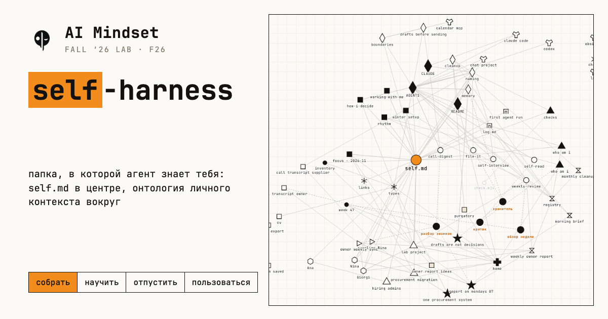

# F26 · Fall Lab · AI Mindset

Осенняя лаборатория AI Mindset, 09.11–07.12.2026. Результат лабы – рабочая личная система: папка контекста, правила для агента, навыки и рутины, которые работают каждый день.

Здесь лежит то, что нужно участнику руками: стартер-кит папки контекста, программа по неделям и описание харнеса. Записи и материалы встреч – в LMS.

## четыре недели

| неделя | слово | что появляется |
|---|---|---|
| 09.11 | собрать | папка о себе: `self.md`, `AGENTS.md`, имена файлов |
| 16.11 | научить | навыки: агент учится твоим повторяющимся задачам |
| 23.11 | отпустить | рутины: агент работает по расписанию без тебя |
| 30.11 | пользоваться | система в работе, подготовка к показу |
| 07.12 | показ | Demo Day |

## неделя

| день | формат | зачем |
|---|---|---|
| пн 19:00 CET | воркшоп Алекса | новый слой системы, руками на своём |
| вт 10:00 CET | коворкинг с кураторами | делаешь домашку рядом с другими, тройка рядом |
| ср | трек Кирилла Олейниченко | свой проект, следующий шаг |
| пт | гость | чужая система и вещь, которую можно поставить себе |
| сб | office hours | вопросы и показ домашки |

## что здесь

```
kit/            стартер-кит: папка context/ с self.md, AGENTS.md, CLAUDE.md
program/        программа встреч, начиная с воркшопа 1
harness.md      как растёт личная система от папки до рутин
harness/        граф и демо: как папка растёт по неделям – 12 фаз, 86 файлов, онтология, план и люди лабы, 10 практик
```

Граф роста папки: https://f26-harness.lab.aimindset.org/ · свой запуск – [`harness/README.md`](harness/README.md).

[](https://f26-harness.lab.aimindset.org/)

Начать: скачай репозиторий (зелёная кнопка **Code → Download ZIP**) или `git clone https://github.com/ai-mindset-org/f26-lab`, открой `kit/README.md`.

## правило лабы

Одно обязательное правило – имена файлов: `{тип} Описание – ГГГГ-ММ-ДД.md`. Остальное подстраиваешь под себя.

---

AI Mindset · https://aimindset.org
