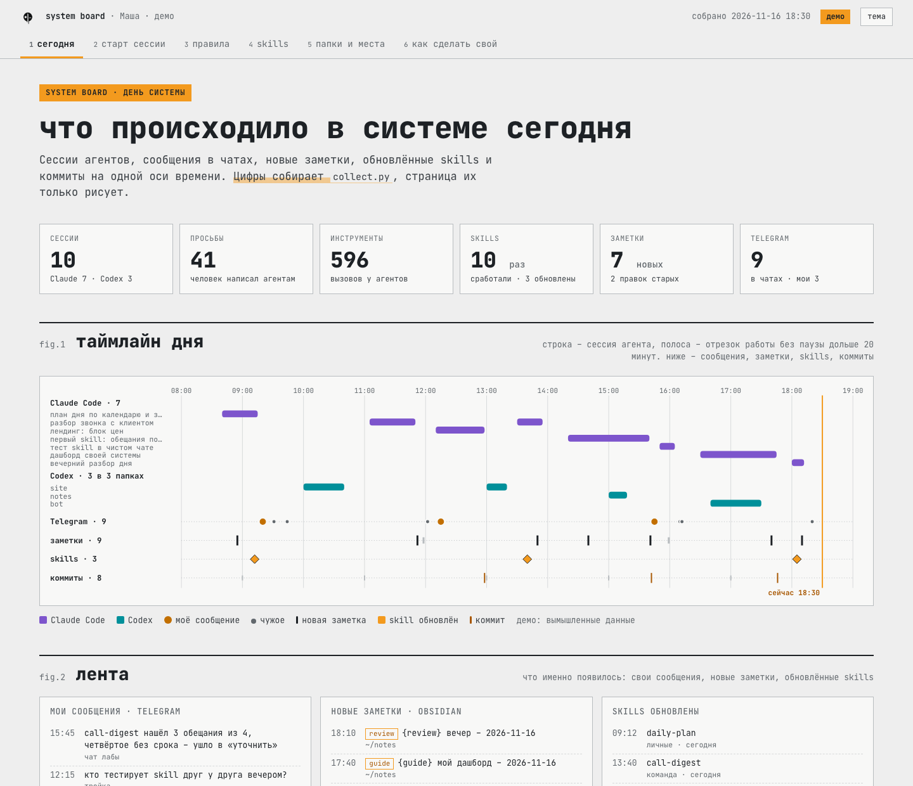

# system board · дашборд своей системы агентов

Одна страница с шестью вкладками: что происходило в твоей системе сегодня, что агент знает до первого слова, какие правила читаются всегда, какие skills растут и чинятся, где что лежит. Пример к неделе 2 «научить» лаборатории F26.



Демо открывается без установки: вымышленная участница Маша, ни одной настоящей цифры. Свои данные собирает `collect.py` с твоей машины, и они на ней остаются.

## запуск за три команды

```
cd dashboards/system-board
python3 -m http.server 8981 --bind 127.0.0.1     # демо: http://127.0.0.1:8981/?demo
cp config.example.json config.json               # свои пути, см. ниже
python3 collect.py && python3 collect.py --show  # свои данные: http://127.0.0.1:8981/?full
```

Нужен Python 3.10+ без пакетов. Проверка `node check.mjs` требует Playwright (`npm i -g playwright && npx playwright install chromium`), её можно поручить агенту.

## вкладки

| вкладка | вопрос | откуда |
|---|---|---|
| 1 сегодня | где ушёл день: сессии Claude Code и Codex, сообщения, заметки, skills, коммиты на одной оси | `~/.claude/projects`, `~/.codex/sessions`, волт, экспорт Telegram, git |
| 2 старт сессии | что срабатывает на каждом шаге и сколько окна съедено до первого слова | `settings.json`, файлы правил, описания skills |
| 3 правила | какие разделы правил самые тяжёлые и какие помечены CRITICAL | главный файл правил |
| 4 skills | какие skills простые, какие стали программами, что чинил за 14 дней, что сработало сегодня | папки skills, транскрипты |
| 5 папки и места | где что лежит и что тяжелее всего | корни из config |
| 6 как сделать свой | эта инструкция и шаблоны прямо на странице | – |

## как устроено

```
система (~/.claude · ~/.codex · волт · skills · Telegram)
   → collect.py          только читает, настраивается в config.json
   → data.json           полный, остаётся на твоей машине
   → data-show.json      для показа: без названий, текстов, имён файлов
   → index.html          рисует json, своих цифр не держит
   → check.mjs           1440 и 390 px, две темы, ошибки консоли, снимки
   → runs.md             строка на запуск
```

Страница выбирает данные сама: `?full` – `data.json`, `?demo` – `demo/data.json`, без параметра – `data-show.json`, а если его нет, демо.

## четыре просьбы агенту

Каждую – в новом чате, запущенном в этой папке. Агент любой: Claude Code, Codex, Cursor.

1. **опись.** «Посмотри мои папки: `~/.claude`, `~/.codex` и волт `<путь>`. Выпиши таблицей: что агент читает всегда, где skills и правила, где журнал, куда уходит результат. Ничего не меняй. В конце – черновик `config.json` по `config.example.json`.»
2. **свои данные.** «Заполни `config.json`, запусти `python3 collect.py` и `python3 collect.py --show`. Покажи, какие разделы `data.json` пустые и почему.»
3. **свой вид.** «Открой страницу через `python3 -m http.server 8981`. Поменяй токены цвета в `:root` на `<мой референс>`. Добавь одну фигуру: `<вопрос, на который хочу видеть ответ каждый день>`. Проверь на 390 px и в тёмной теме, покажи снимок.»
4. **в skill.** «Запиши то, что мы сделали, в `.claude/skills/system-board/SKILL.md` короче 40 строк: цель, вход, шаги, проверка, журнал, никогда. Потом в новом чистом чате: „обнови дашборд системы“ – и строка в `runs.md`.»

Готовый skill уже лежит в `.claude/skills/system-board/` (для Codex – ссылка `.agents/skills`). Его можно взять как есть и поправить под себя.

## правила дашборда

1. **страница без цифр.** Все числа живут в json. Страница их рисует и не знает ничего сама
2. **сборщик только читает.** `collect.py` ничего не пишет в систему, ошибка сборки не ломает работу
3. **два файла данных.** Полный остаётся на машине. Для показа – отдельный, личное вырезается при сборке, до страницы
4. **фигура = вопрос.** У каждой фигуры номер `fig.N` и вопрос в шапке. Нет вопроса – нет фигуры
5. **одна ось.** Две величины разной шкалы – два ряда. Двух осей на одном графике нет
6. **цвет по роли.** Человек, агент, вторая модель – три цвета на всю доску. Палитру проверяет скрипт, глаз её не проверяет
7. **наведение везде.** Каждая полоса и точка отвечает на наведение: что, когда, сколько
8. **источник подписан.** Под фигурой видно, откуда цифра и как считана, оценка помечена знаком ≈
9. **проверка снимком.** 1440 и 390 px, светлая и тёмная тема, ошибки консоли. Снимок смотришь глазами
10. **журнал запусков.** `runs.md`: дата, что собрано, что поправить. Три строки показывают, что менять

## config.json

| поле | что | пример |
|---|---|---|
| `owner` | подпись в шапке | `"Маша"` |
| `claude_dir`, `codex_dir` | папки агентов | `"~/.claude"`, `"~/.codex"` |
| `always` | файлы, которые агент читает в каждой сессии; первый разбирается на разделы | `~/.claude/CLAUDE.md`, `~/notes/AGENTS.md` |
| `skill_dirs` | папки skills с подписью; при дублях побеждает первая | `~/.claude/skills` |
| `public_skill_sources` | подписи папок, чьи имена skills можно показывать | `["команда"]` |
| `vaults` | волты Obsidian: новые и изменённые сегодня заметки, коммиты | `~/notes` |
| `telegram` | свой json или экспорт Telegram Desktop | `telegram-export/result.json` |
| `telegram_me` | твой id в экспорте, чтобы отличить свои сообщения | `"123456789"` |
| `roots` | корни для вкладки «папки»; `"count": "projects"` считает проекты вместо md | `~/notes`, `~/code` |
| `places`, `lanes`, `servers` | необязательные списки: места агентов, планировщики, серверы | – |

**Telegram.** Telegram Desktop → чат → ⋮ → «Экспорт истории» → формат JSON, без медиа. Путь к `result.json` – в поле `telegram`. Сборщик берёт сообщения за сегодня; текст хранит только у твоих, у чужих – время и чат.

## показ

`python3 collect.py --show` убирает названия сессий, тексты сообщений, имена заметок, описания skills и имена личных skills. Остаются числа, время и типы. После сборки проверь поиском по `data-show.json`, что имён людей и слов из разговоров там нет. `data.json`, `config.json` и экспорт Telegram в git не идут: они в `.gitignore`.

## что ещё можно показать

Пятнадцать шаблонов с вопросом, источником, формой и ловушкой – в [PATTERNS.md](PATTERNS.md). Шесть уже на доске, девять ждут своего вопроса.

## файлы

| файл | роль |
|---|---|
| `index.html` | страница, токены цвета в `:root`, клавиши 1–6 и S |
| `collect.py` | сборщик, только чтение |
| `config.example.json` | пример настроек |
| `demo.py`, `demo/data.json` | вымышленные данные той же схемы |
| `check.mjs` | проверка Playwright |
| `.claude/skills/system-board/SKILL.md` | skill, который обновляет доску |
| `runs.md` | журнал запусков |
| `PATTERNS.md` | гайд: какие ещё шаблоны можно показать из волта |

---

AI Mindset · F26 · неделя 2 «научить» · 16.11.2026
