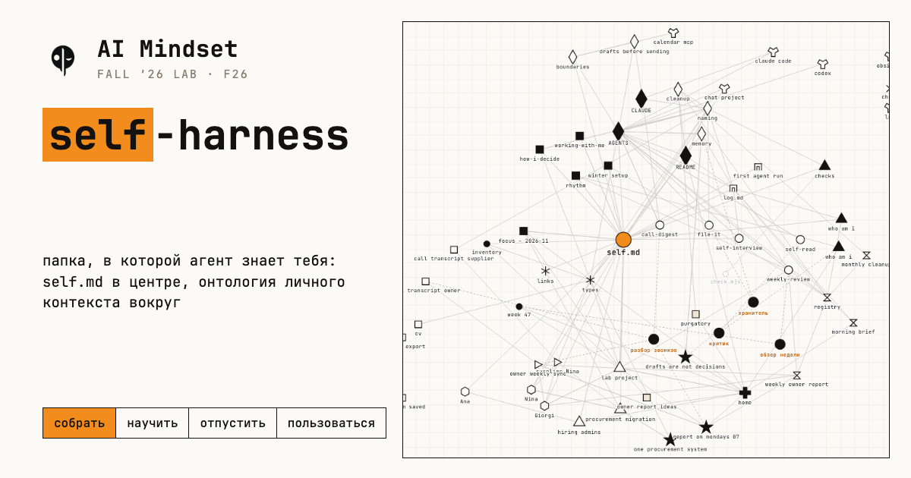
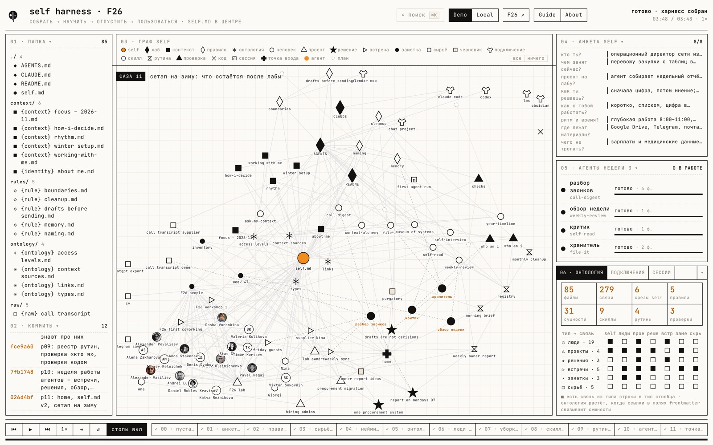
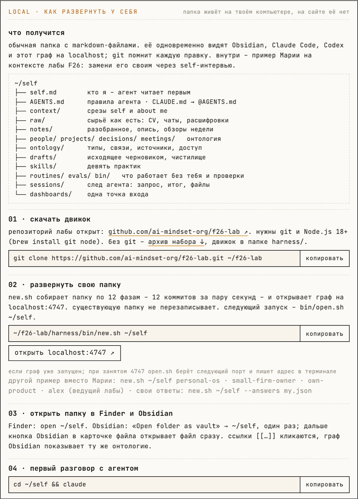
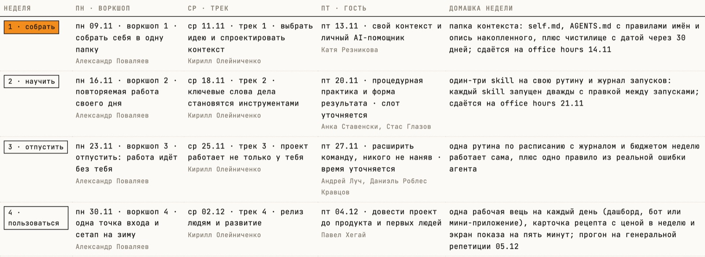
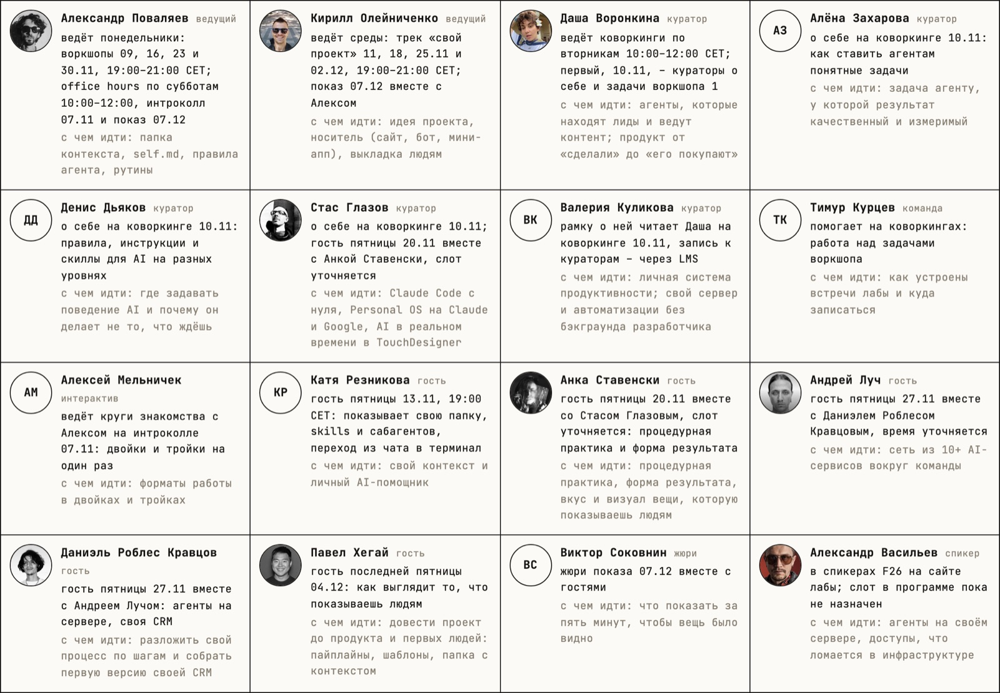
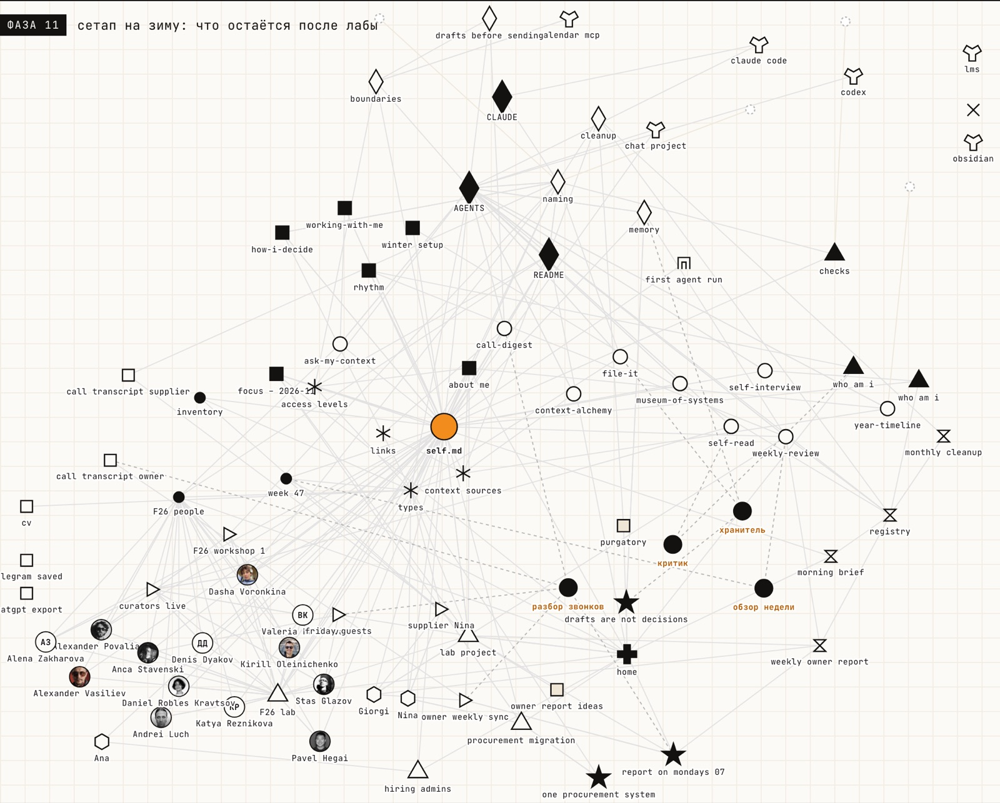

# self-harness · F26

[](https://f26-harness.lab.aimindset.org/)

**[открыть харнесс](https://f26-harness.lab.aimindset.org/)** · [гид](https://f26-harness.lab.aimindset.org/guide.html) · [About и онтология](https://f26-harness.lab.aimindset.org/access.html) · [архив набора ↓](https://f26-harness.lab.aimindset.org/f26-self-harness-kit.zip)

Папка, в которой агент знает тебя. За четыре недели лабы F26 из пустой папки вырастает `self.md` в центре, правила агента, сырьё с описью, правило имён, онтология личного контекста, люди лабы, десять практик, рутины с проверками и одна точка входа. Демо проигрывает рост по 12 фазам: каждая фаза – коммит, после каждой – карточка с объяснением. Стрелки ← → переключают фазы, клик по фазе внизу возвращает к ней.

Набор показан на контексте самой лабы: 16 человек F26 – ведущие, кураторы, команда, гости пятниц и жюри показа – лежат в `people/` карточками с аватарками, план 22 встреч из публичной программы https://f26-program.lab.aimindset.org/ – в `{project} F26 lab`. Это пример на 09.11.2026, он будет дорабатываться по ходу лабы.



## четыре недели · 12 фаз

| неделя | фазы | что появляется в папке |
|---|---|---|
| 1 · собрать · 09.11 | 00 пустая папка · 01 анкета → `self.md` · 02 правила агента · 03 сырьё и опись · 04 нейминг · 05 онтология · 06 люди лабы · 07 уборка и границы | `self.md`, `AGENTS.md`, `context/`, `raw/`, `{rule} naming`, `ontology/` (типы, связи, источники, доступ), `{identity} about me`, план лабы и её люди, проекты, решения, встречи, `drafts/` и чистилище |
| 2 · научить · 16.11 | 08 скиллы своей рутины | десять практик в `skills/` |
| 3 · отпустить · 23.11 | 09 рутины и проверки · 10 агенты параллельно | `routines/` с реестром и бюджетом, `evals/` «кто я», `bin/check.mjs`, четыре полосы агентов, `{rule} memory`, сбой → `decisions/` |
| 4 · пользоваться · 30.11 | 11 точка входа и петля | `{dashboard} home`, `self.md` v2 с разделом «что выучено», сетап на зиму |

На воркшопе 1 показываются фазы 00–07. Остальные слои видны на графе пунктиром как план.

## развернуть у себя

Нужны git и Node.js 18+ (`brew install git node`).

```bash
git clone https://github.com/ai-mindset-org/f26-lab.git ~/f26-lab
~/f26-lab/harness/bin/new.sh ~/self                  # папка по набору + граф на http://localhost:4747/
~/f26-lab/harness/bin/new.sh ~/self personal-os      # другой пример: small-firm-owner · own-product · personal-os · alex
~/f26-lab/harness/bin/new.sh ~/self --answers my.json  # свои ответы анкеты
~/f26-lab/harness/bin/open.sh ~/self                 # открыть граф снова
open ~/self                                          # папка в Finder
cd ~/self && claude                                  # первый разговор с агентом
```

`new.sh` собирает папку за 12 коммитов и открывает граф. Существующую папку он не перезаписывает. В Obsidian: «Open folder as vault» → `~/self`, один раз; дальше кнопка Obsidian в карточке файла открывает файл сразу.

Без терминала: страница Local на сайте открывает папку прямо в Chrome, Arc или Edge.



## как передать кит

| кому | что дать |
|---|---|
| участник с git | ссылку на репозиторий и две строки выше: `git clone` и `new.sh` |
| участник без git | [архив набора](https://f26-harness.lab.aimindset.org/f26-self-harness-kit.zip): стартер-кит воркшопа 1, набор под финальными именами, движок, граф. Или кнопка **Code → Download ZIP** на GitHub |
| тройка или куратор | свою папку отдельным приватным репозиторием: `cd ~/self && gh repo create my-self --private --source . --push`, потом добавить человека в доступ. Файлы с `access: T3` и выше в такой репозиторий не кладутся |
| свой агент | путь к папке: `AGENTS.md` и `self.md` агент читает первыми |

Внутри архива `START-HERE.md`: с чего начать вечером после воркшопа.

## лаба F26: план и люди

`projects/{project} F26 lab.md` держит неделю участника и план 22 встреч: интроколл 07.11, четыре недели по пять встреч (пн воркшоп, вт коворкинг, ср трек, пт гость, сб office hours) и показ 07.12. У каждой недели домашка и шаг проекта. Слоты с пометкой «уточняется» ещё сверяются; сдвиг слота – правка одной строки.



Люди – из публичной программы и блока спикеров f26.aimindset.org. В карточке три строки: кто, что ведёт в лабе, с чем к нему идти. Фото – с сайта лабы, у кого фото нет – инициалы.



Указатель `notes/{index} F26 people – 2026-11-09.md` отвечает на вопрос «к кому идти с моим вопросом». Встречи `meetings/{meeting} F26 workshop 1`, `F26 first coworking`, `friday guests` связывают людей с проектом лабы.

## что открыто наружу

Репозиторий и сайт публичные, поэтому в наборе только публичный слой. Люди – имя, роль в лабе, слот и тема из публичной программы и с сайта лабы. Контактов, денег, переписки, здоровья и личной жизни нет ни у кого. Пресет `alex` собран из публичного профиля ведущего: роль, метод, инструменты. Примеры участниц вымышлены. Проверка перед каждой выкладкой – gitleaks и поиск по почтам, хэндлам, телефонам и внутренним адресам.

## онтология личного контекста

Тип в имени файла, `id` и `type` во frontmatter, связи – ссылки `[[...]]` в полях. Граф рисует именно их.

| тип | папка | доступ | что |
|---|---|---|---|
| `self` | корень | T1 | кто я, чем занят, как со мной работать |
| `identity` | `context/` | T0 | публичная половина self: `{identity} about me` |
| `context` | `context/` | T1 | срезы: как решаю, ритм, как со мной работать |
| `person` | `people/` | T0–T3 | люди: из звонков, из лабы, из переписки |
| `project` · `decision` · `meeting` | свои папки | T1–T2 | проекты, решения с причиной, встречи с источником |
| `note` · `index` | `notes/` | T1 | обзоры недели, опись, указатели |
| `raw` | `raw/` | T1–T3 | сырьё как есть: CV, чаты, расшифровки |
| `session` | `sessions/` | T1 | след агента: запрос, итог, тронутые файлы |
| `corpus` | вне папки | T3–T4 | дневник, терапия, здоровье: в описи только указатель |

Уровни доступа: **T0** публичное · **T1** рабочее · **T2** адресное · **T3** личное · **T4** уязвимое. Поле `access` решает, что агент читает на старте, что показывает только адресату и что не читает без просьбы.

`{ontology} context sources` описывает 12 мест, откуда берётся контекст (анкета, CV, звонки, чаты, заметки, календарь, почта, задачи, сайт, голос, обзоры, сессии агента), и петлю захват → дистилляция → хранение → применение. Раздел «у ведущего лабы» показывает шесть типов из личного контекста Алекса Поваляева: `identity`, `context`, `source`, `corpus`, `index`, `trace`.



## десять практик

Каждая практика – файл `skills/{skill} имя.md`: когда запускать, что на входе, шаги, что на выходе, как проверить, готовый промпт и время.

| практика | что делает | время |
|---|---|---|
| `attention-orbit` | орбита внимания на экране: две точки, всё поле, куб Неккера, точки под закрытыми веками; итог – одно слово в `self.md`. Страница: https://practices.lab.aimindset.org/orbit.html | 3–6 мин |
| `self-interview` | интервью в три круга: факты, примеры из последних двух недель, уровни – заполняет и правит `self.md` | 20–30 мин |
| `self-read` | тройка читает твой `self.md` чужими глазами | 15 мин на человека |
| `ask-my-context` | вопрос своей папке: ответ из файлов с названиями файлов | 2 мин |
| `call-digest` | расшифровка звонка → встреча, решения, люди | 5 мин |
| `file-it` | разложить сырьё по онтологии | 10 мин |
| `weekly-review` | пятница: обзор недели одной страницей | 10 мин |
| `context-alchemy` | смешать два источника и найти то, чего не видно в каждом | 30 мин |
| `museum-of-systems` | что я запускал и бросил, правило загрузки на будущее | 40 мин |
| `year-timeline` | сюжет года: фазы, события, три письма себе | 1 час |

Claude Code ищет скиллы в `.claude/skills/<имя>/SKILL.md`: когда практика заработала, скопируй её туда.

## правило имён

`{type} описание – YYYY-MM-DD.md`: тип в фигурных скобках, дата в конце после короткого тире, имена людей латиницей, русское имя – в `aliases`. Журнал папки – история git, `sessions/` и обзоры недели; отдельного файла-журнала в наборе нет.

```
Даша куратор.md            →  people/{person} Dasha Voronkina.md   + aliases: Даша Воронкина
воркшоп 1 заметки.md       →  meetings/{meeting} F26 workshop 1 – 2026-11-09.md
```

## устройство

```
harness/
├── kit/files/        набор: 86 файлов под финальными именами, тексты – шаблоны {{ключ}} из анкеты
├── kit/manifest.json 12 фаз: шаги, заметки, коммиты, карточки-остановки
├── kit/answers/      примеры: small-firm-owner · own-product · personal-os · alex; по умолчанию – Мария, операционный директор сети клиник
├── tools/gen-kit.py  единый источник: тексты, фазы, пресеты, практики в гиде, люди в About
├── tools/og.html     превью ссылки 1200×630 → web/og.png
├── web/              граф (d3): Demo · Local, Guide, About
├── bin/              new.sh · open.sh · replay.sh · stop.sh · deploy-site.sh
└── docs/             картинки для этого README
```

Правка набора: `python3 tools/gen-kit.py && node tools/build-scenario.mjs`, проверка `node tools/harness-demo.mjs --dir /tmp/self-check --pace 0`. Выкладка открытой копии – `bin/deploy-site.sh <дерево lab-sites>`. Стартер-кит воркшопа 1 живёт в [`../kit/`](../kit/), описание слоёв – [`../harness.md`](../harness.md).

## откуда

Форк [`ai-mindset-org/marketing-harness`](https://github.com/ai-mindset-org/marketing-harness) (32490c2, 09.11.2026): движок графа, таймлайн фаз, локальный сервер. Набор, слои графа, панель онтологии, люди лабы, практики, тексты и оранжевая тема F26 сделаны для лабы. Живые агенты фазы 10 воспроизводятся по сценарию.
